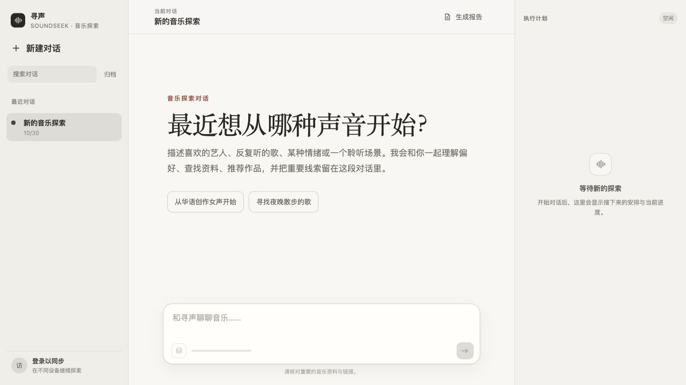
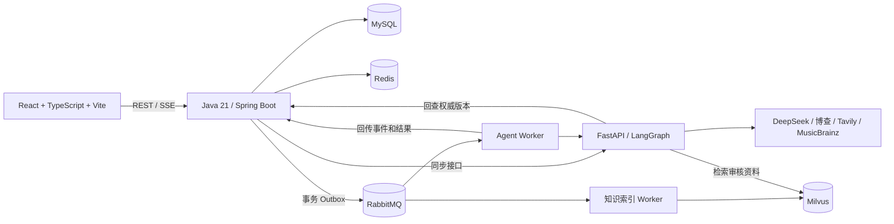

# 寻声 SoundSeek

寻声是一款由 AI Agent 驱动的中文音乐探索 Web 应用。用户可以从一首歌、一位艺人或一个聆听场景开始，得到有据可查的推荐、歌曲分析和试听入口。也可以用自然语言继续调整方向，例如“保留上一轮第二首，再找几首更偏现场版的”。

访客可从首页直接开始探索。登录后可归并访客对话、收藏和其他资产，并在不同设备继续访问。



*本地图示使用示例会话。*

## 核心功能

| 功能 | 体验 |
| --- | --- |
| 多轮音乐探索 | Agent 结合会话、偏好和上一轮结果寻找歌曲与艺人。推荐卡保留曲目、来源和试听入口，可以收藏、反馈或继续追问。 |
| 歌曲深度研究 | Agent 按需检索和精读公开资料，核验作品、录音与署名。分析卡展示来源、证据边界及冲突。 |
| 图片与文档对话 | 在首页或工作台添加图片、TXT、Markdown 和可提取文字的 PDF。可以预览、混合发送及刷新后追问。点击文档引用，可查看对应的 PDF 页文字或带行号的文本片段。 |
| 我的音乐 | 保存与搜索歌曲、回看推荐理由、把收藏带回对话继续探索。试听使用 Apple iTunes US 目录，并提供平台搜索入口。 |
| 探索报告与歌曲世界杯 | 可生成探索报告。用户明确发起两两对决时，可创建 16 或 32 首歌曲的比赛，候选分别至少需 24 或 48 首。指定艺人时会逐页读取 MusicBrainz 录音目录并去重，完成比赛后可生成赛后偏好报告。 |
| 账号与资产同步 | 邮箱确认注册、找回和修改密码、修改邮箱、全端退出，以及配置后可用的 GitHub 登录。 |

## AI 与 Web 实现

- **统一 ReAct Agent。** LangGraph 运行时通过 Function Calling 选择动作，按需搜索、核验、读取资料、澄清或生成结果。公开网络负责发现线索，MusicBrainz 核验歌曲与艺人身份，Java 负责规范化与落库。
- **带来源的音乐证据库。** 维护者录入或导入资料，审核后发布。检索结合实体约束、精确匹配与 Milvus 向量召回，再回查已发布版本和来源。证据库补充事实、归因和解释，公开网络与 MusicBrainz 继续承担歌曲发现和身份核验。
- **图像理解与文档问答。** 图片以多模态输入交给模型。文档由服务端解析，长文档可由 Agent 自主搜索和按页读取。上传资料按会话鉴权，公开引用可定位到对应文字。
- **可恢复的流式交互。** React 从首页按需加载探索工作台。SSE 展示可公开的计划、工具摘要和回答，断线后可继续接收。生成时可以停止、排队发送下一条消息，或显式补充本轮方向。

## 技术架构



| 目录 | 职责与依赖 |
| --- | --- |
| [web](./web/) | React 18、TypeScript、Vite 和 Vitest。首页、对话工作台、附件预览、报告和账号界面。 |
| [java-service](./java-service/) | Java 21、Spring Boot 3.4、Spring Security、Flyway。维护会话、附件权限、领域数据和 Agent Run。 |
| [agent-service](./agent-service/) | Python 3.12、FastAPI、LangGraph、LangChain 和 Pydantic。运行统一 Agent、工具与后台 Worker。 |
| [infra](./infra/) | Docker Compose。MySQL 持久化、Redis 会话与限流、RabbitMQ 任务队列，以及可选的知识索引和可观测性组件。 |
| [Demos](./Demos/) | 接口验收脚本与歌曲推荐、分析、知识检索评测。 |

## 安装与运行

### 1. 准备环境并下载代码

安装 Git 和 Docker Desktop，或准备已启用 Docker Compose 插件的 Docker Engine。启动 Docker 后，在终端执行以下命令。Compose 会在构建时安装前端、Java 和 Python 的依赖。

```bash
git clone https://github.com/garfieldra/ProjectChuanZhi.git
cd ProjectChuanZhi
cp .env.example .env
```

### 2. 配置本地环境

按 [环境变量模板](./.env.example) 编辑本地 `.env`，为数据库、消息队列和服务间鉴权设置独立凭据。体验完整的 AI 对话和在线推荐时，在本地配置模型服务和至少一个搜索服务的凭据。真实凭据仅保存在本地 `.env` 或部署环境中。

### 3. 构建并启动服务

在项目根目录运行。首次构建需要下载镜像和依赖。

```bash
docker compose --env-file .env -f infra/compose.yaml up -d --build web agent-service agent-worker
docker compose --env-file .env -f infra/compose.yaml ps
```

打开 <http://localhost:5173>。可先以访客身份输入“推荐几首适合夜晚散步的独立流行，我喜欢徐佳莹”，再从推荐卡试听、收藏或继续追问。Java API 文档在 <http://localhost:8080/swagger-ui/index.html>。

如果页面未能打开，先确认容器状态，再检查 Java 的健康接口和相关服务日志。

```bash
curl -fsS http://localhost:8080/actuator/health
docker compose --env-file .env -f infra/compose.yaml logs --tail=80 web java-service agent-service agent-worker
```

### 4. 按需启用音乐证据库和邮箱注册

启用音乐证据库后，可以检索已审核发布的音乐资料。维护者需要已验证的邮箱，账户 UUID 需列入 `KNOWLEDGE_MAINTAINER_IDS`。配置方法和导入流程见 [RAG 维护说明](./docs/rag-maintenance.md)。

```bash
docker compose --env-file .env -f infra/compose.yaml -f infra/compose.knowledge.yaml \
  --profile knowledge up -d --build web agent-service agent-worker knowledge-worker
```

本地测试邮箱注册前，按 [账号维护说明](./docs/account-maintenance.md) 生成并配置本地邮件加密密钥。启动以下配置后，在 <http://127.0.0.1:8025> 查看 Mailpit 测试收件箱。

```bash
docker compose --env-file .env -f infra/compose.yaml -f infra/compose.auth-mail.yaml \
  --profile auth-mail up -d --build web agent-service agent-worker
```

同时体验两项能力时，在同一条启动命令里传入两个叠加文件及各自的 profile，并启动 `knowledge-worker`。正式 SMTP 和 GitHub 登录配置见 [账号维护说明](./docs/account-maintenance.md)。

### 5. 停止服务

```bash
docker compose --env-file .env -f infra/compose.yaml down
```

使用了叠加配置时，停止命令也应带上相同的 Compose 文件和 profile。以上停止命令会保留数据卷。

### 部署与数据

公网部署参考 [生产环境变量](./.env.production.example)、[Caddy 配置](./web/Caddyfile)和 [生产 Compose 模板](./infra/compose.production.yaml)。当前生产模板还需补齐 RabbitMQ 和 Agent Worker，并复验公开环境下的流式对话。演示完整功能可用上面的本地配置。

Flyway 当前迁移到 `V28`。备份应同时覆盖 MySQL 和 Java 的附件目录 `/app/data/attachments`。本地 Compose 目前把附件卷挂在 Web 容器上，需要将卷挂到 Java 容器才能让附件跨容器重建保留。复用曾执行旧版 `V24`、`V25` 附件迁移的库时，先核对 Flyway 历史再切换。

## 测试与验收

2026 年 11 月 16 日，主分支合并提交 `a32d22a` 通过 **Web 84 项、Java 79 项、Agent 140 项**测试，Web 生产构建和 Java 打包通过。Java 21 容器中的集成测试验证了账号安全、RAG 接口、任务队列和附件迁移。

```bash
npm --prefix web ci
npm --prefix web test
npm --prefix web run build

docker build --target test -t soundseek-agent-test agent-service
docker run --rm soundseek-agent-test
```

Java 回归可在 Docker Desktop 上使用 Java 21 容器执行。Testcontainers 会启动独立的 MySQL、Redis 和 RabbitMQ。

```bash
docker run --rm \
  -v "$PWD/java-service:/source:ro" \
  -v soundseek-maven-cache:/root/.m2/repository \
  -v /var/run/docker.sock:/var/run/docker.sock \
  -e TESTCONTAINERS_HOST_OVERRIDE=host.docker.internal \
  maven:3.9-eclipse-temurin-21 \
  sh -ec 'mkdir -p /tmp/soundseek-java && cp -R /source/pom.xml /source/src /tmp/soundseek-java/ && cd /tmp/soundseek-java && mvn -B -Dapi.version=1.44 verify'
```

已启动的应用可用 [端到端验收脚本](./Demos/verify_full_user_flow.py)和 [音乐服务验收脚本](./Demos/verify_music_providers.py)验证，涉及模型或外部服务的场景需要对应配置。

- [图片理解验收](./Specs/04-功能规格/28-对话图像附件与多模态消息.md) · [文档问答验收](./Specs/04-功能规格/29-会话文档附件与可追溯问答.md) — 真实模型、桌面及移动尺寸交互。
- [RAG 验收](./docs/rag-validation.md) · [检索评测方法](./Demos/evals/knowledge/README.md) — 索引、检索和引用已在隔离环境验证，真实音乐语料的召回和引用支持率待评测。
- [账号验收](./docs/account-validation.md) — 隔离 SMTP 发信、邮箱确认、找回、旧会话撤销和访客归并。正式 SMTP 投递和真实 GitHub OAuth 需在配置后复验。

更多设计见 [规格目录](./Specs/README.md)、[首页交互](./docs/homepage-design.md)和 [工作台视觉规范](./docs/workspace-visual-system.md)。

## 参赛团队

- **学校**　西安交通大学
- **成员**　李岩润、王睿、王兆晨
