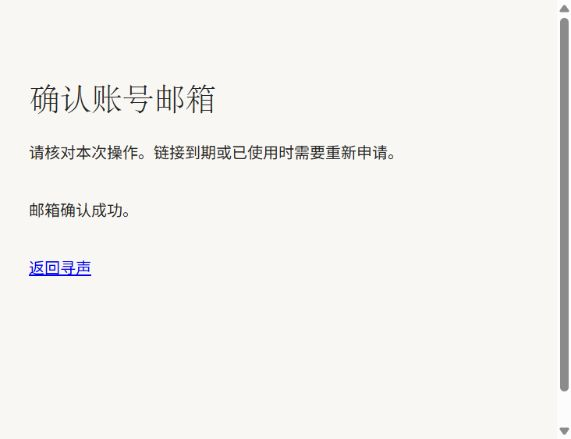
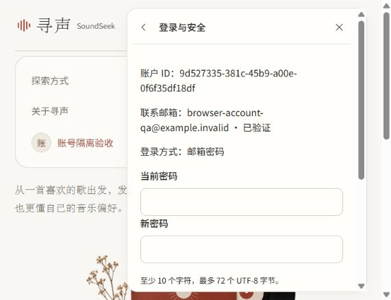
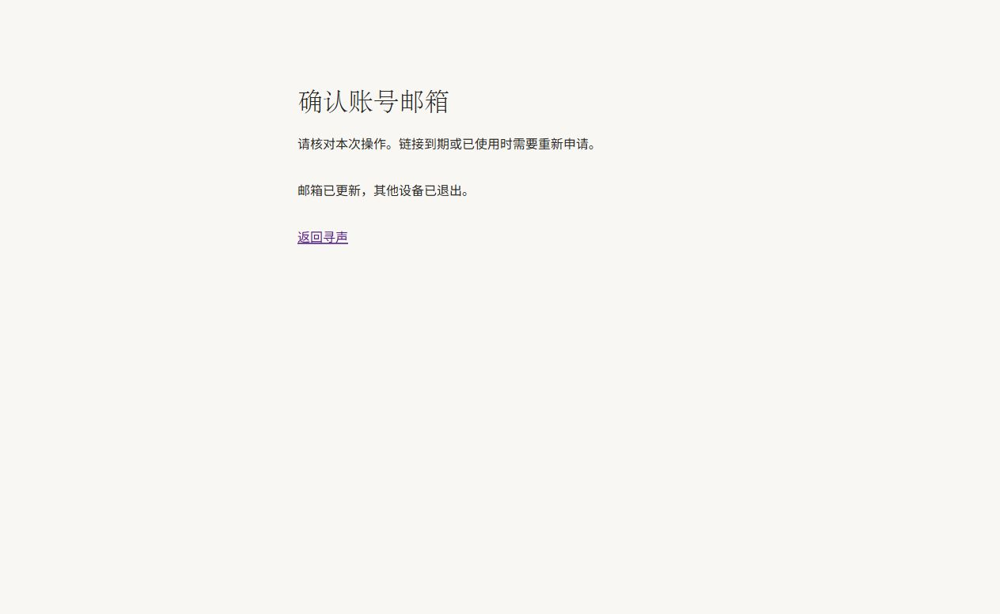

# 账号系统验证记录

日期：2026-11-11。分支 `codex/account-system-improvements`，基于 `main@8811b63` 的账号功能实现，具体提交见 Git 记录。运行与配置见 [账号维护说明](./account-maintenance.md)，范围见 [账号方案](./account-system-design.md)。

## 自动检查

- 完整 Java 回归：59 项，0 失败、0 错误、0 跳过；包含真实隔离 MySQL、Redis、RabbitMQ 的 Spring 集成、V23→V26 升级和已有 RAG 检查。
- 最后补充并发资料更新保护和策略配置后，账号相关定向复验 18 项全部通过。其中账号集成 8 项，覆盖并发消费、期满/错用途、幂等注册、改密/改邮箱、全端退出、权限与停用，以及昵称更新不能回写已撤销的会话版本。定向数量不与完整回归数量相加冒充总测试数。
- 验收用 Java 可执行包构建成功。首次离线打包缺少插件依赖，改用已有 E 盘缓存及配置镜像补齐后通过；没有跳过失败业务测试来宣称打包通过。
- Web：70 项通过，TypeScript/Vite 生产构建通过。包括恢复请求的幂等重试、CSRF 刷新、超时和多字节密码边界。
- Compose：标准配置叠加知识组件、本地邮件 profile 的解析通过；不代表本分支已上线部署。

Maven 在独立容器中复用 `E:/Caches/maven`，本机 Docker API 兼容参数为 `-Dapi.version=1.44`。一次性 MySQL 测试关闭 TLS 以避免逐连接握手开销，此设置仅在测试容器声明内，未改生产数据库连接配置。未复制本机 application-local.yml 到测试产物。

## 隔离接口与 SMTP

集成测试使用进程内 SMTP 测试接收器，实际完成 SMTP 会话和邮件接收；凭据、地址与材料均为合成数据，不连接生产邮件账号。验证以下链路：

- 注册申请时无正式账户，错误跨浏览器凭据不能消费挑战，确认后邮箱已验证并保留当前访客资料。
- 找回与改密后旧设备失效；令牌原子单次消费，过期、重复、错用途和并发第二次消费均拒绝。
- 邮箱变更要求近期认证，旧登录地址与会话失效；全端退出需再认证。
- 抢注旧白名单邮箱不能获得知识维护权限；仅显式 UUID 且已验证的 ACTIVE 账户可管理。
- 停用后旧 Session 与新密码登录被拒绝，预览的业务资产数量保持不变。没有实现或执行账号物理删除。
- CSRF、发信限流、同一幂等请求不得替换注册密码、普通资料写入不得降低 auth_version。

另启动一次性账号 API、MySQL/Redis/RabbitMQ 和 Mailpit，在独立网络中验收；前端 15173、API 18080、Mailpit 18025 只绑定本机。SMTP 收件箱停止后 `/actuator/health` 仍返回 UP，证明邮件故障不阻断普通健康检查。

## 实际浏览器

- 首页注册表单提交后提示“请求已受理”，仍保留访客状态；Mailpit 实际收到该申请的确认邮件。
- 通过邮件链接打开确认页，确认后显示“邮箱确认成功”，URL 中的令牌已清理，返回首页显示正确账号。
- 打开“设置 → 登录与安全”，展示已验证邮箱、登录方式、改密/改邮箱/全端退出入口与停用范围说明。
- 验收发现并修正已有页面内哈希跳转不进入确认页，以及 StrictMode 下在 render 内清理 URL 导致状态丢失的问题；复查确认成功。
- 浏览器在全端退出确认弹窗后出现工具超时。服务端已记录本次测试账号的 LOGOUT_ALL 事件，但未将其后的页面返回状态视为已观察；全端退出和旧设备失效由真实接口集成测试覆盖。

## 2026-11-12 Review 修复复核

先在修复前代码上新增回归：注册确认、密码找回确认分别因另一访客的无效令牌返回 429；21 个代理来源 IP 的发信请求被合并限流；携带加密邮箱确认目标的 GitHub 回调丢失目标。以上均出现预期失败，非可信直连来源伪造转发头仍受限的对照通过。

修复后验证：

- Java 完整回归 66 项通过，0 失败、0 错误、0 跳过，覆盖此次生产代码改动及原有业务测试。随后新增确认链接账号绑定/已消费校验、受限回跳测试，账号集成与 OAuth 回调共 17 项定向复验全部通过；该数量与完整回归重叠，不相加。
- 在回归通过后完成 Java 可执行包构建；打包复用已通过的测试结果。
- Web 78 项通过，TypeScript/Vite 生产构建通过；覆盖待办恢复、账号不匹配、时效、取消、失败重试、只保留非敏感字段，以及继续操作前重新读取当前服务端账号。
- 使用真实 Vite 和临时 HTTP 上游，对 `/api`、`/oauth2`、`/login/oauth2` 三条代理路由注入伪造转发头，均观察到上游仅收到真实 socket IP，原始 Forwarded 被移除。
- 真实嵌入式 Tomcat + Redis 集成证明：可信回环代理的不同客户端各用独立发信额度；非可信 socket 地址不能通过轮换 X-Forwarded-For 绕过额度；不同来源的无效确认请求不再封锁其他访客的有效链接。
- 标准和生产 Compose 解析通过；专用代理网络与 `account-api` 上游地址已同步。解析时使用本地开发环境变量，生产 SITE_ADDRESS / MinIO 凭据的缺省警告不代表已配置生产环境。
- GitHub 回调测试验证同一身份、会话轮换后仍能恢复加密邮箱确认目标；错误身份和站外回跳被拒绝。未访问真实 GitHub Provider，不将单元测试称为真实 OAuth 联通或本轮浏览器验收。

本次测试继续使用隔离容器和 E 盘 Maven 缓存，不迁移原业务数据库。部署应重建 Web 与 Java，并按维护说明检查专用网段冲突。

## 2026-11-12 浏览器复验

使用当前分支源码重建隔离 Java，运行当前 Web 源码；独立 MySQL、Redis、RabbitMQ、Mailpit，不连接原业务库。测试用 OAuth Provider 和 Spring 客户端配置仅放在一次性工作目录/测试 classpath，不进入生产代码或可执行包；使用合成 GitHub Subject，未连接真实 GitHub。为检查确认页的二次授权，测试中移除了隔离 Session 的近期认证标记，不等待真实 10 分钟。

实际观察：

- 内置浏览器完成 OAuth 登录，设置页正确显示 GitHub 登录方式及尚未添加邮箱。
- 发起添加邮箱后进入本地授权页，回调到 `#account-security`，原目标邮箱完整恢复；用户点击继续后 Mailpit 收到真实 SMTP 确认邮件。
- 从收件箱打开确认链接，地址栏及时移除令牌；近期认证过期后再次授权，回调直接返回原确认页。无需重开邮件，点击确认后显示“邮箱已更新，其他设备已退出”，设置页显示邮箱已验证。
- 第二次发起邮箱变更，经回调点击“取消操作”后显示取消成功；隔离数据库中该目标邮箱的挑战数为 0，未创建发信待办。
- 全端退出的原生确认框阻塞了内置浏览器自动化；使用 Edge 独立会话继续验收。Edge 完成确认、再次 OAuth 授权、恢复退出待办、点击继续，页面显示“全部设备已退出”；返回首页显示“登录账户”。Edge 最终页面未捕获到 warn/error 控制台日志。内置浏览器中被冻结的旧页面未作为跨设备失效的浏览器观察证据，该项仍由接口回归覆盖。

本轮发现并修复代理端口缺失：Tomcat 原生转发头处理将相对重定向构造成默认 80 端口，导致本地 OAuth 成功页无法访问。现配置 `X-Forwarded-Port`；Vite 从原始 Host 生成端口并覆盖客户端输入，Caddy 覆盖该头为其请求端口，避免将客户端伪造端口传给可信上游。Caddy 占位符依据 [官方说明](https://caddyserver.com/docs/caddyfile/concepts#placeholders)。修复后真实授权回调保留 `15173` 端口；新增嵌入式 Tomcat 重定向回归通过。

修复后的 Java 定向回归 18 项全部通过（账号集成 14、OAuth 回调 4）；Web 78 项和生产构建通过，隔离 Java 打包并实际启动成功。18 项与前次 66 项完整回归重叠，不能相加；本次端口修复后未重复宣称执行完整 Java 回归。

## 边界

不包含真实生产 SMTP 供应商的送达率、退信或反垃圾验证；不宣称已完成真实 GitHub 授权联通。GitHub 停用用户拒绝及再认证逻辑有代码/回归覆盖，前端授权与回调路径已在 Vite/Caddy 转发，生产仍需配置 Provider 与公开回调地址并复验。

没有调用真实 LLM、向外部真实用户发送邮件、对原项目数据库执行迁移或删除资料。原有五个业务容器保持运行。本轮不包含音乐语料质量评测，临时测试容器和收件资料在验收后清理，正常构建依赖缓存保留。
