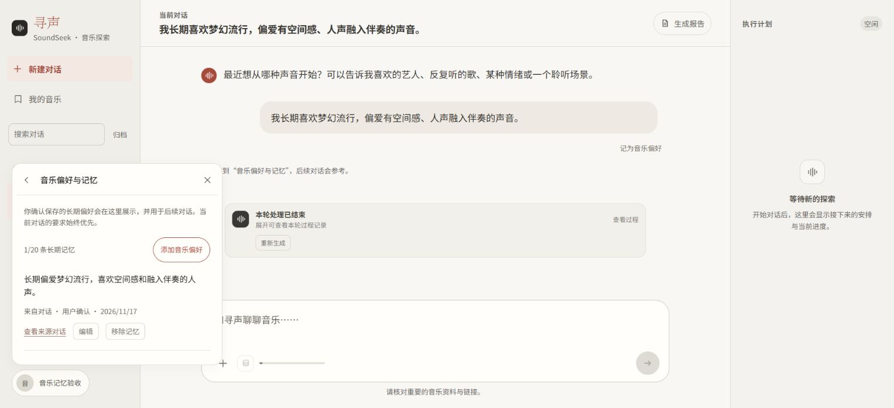

# 音乐偏好与长期记忆

## 使用方式

已登录用户点击头像 → 音乐偏好与记忆，可直接添加、编辑、移除自己的长期偏好。
在探索工作台的已发送文字消息下，也可以点击「记为音乐偏好」，将原文整理为适合长期保留的偏好，明确确认后保存。
消息过长时必须由用户自行整理至 800 字符以内，不静默截断；取消不会写入记忆。

列表展示内容、更新时间和来源。来自对话的记忆可跳回原消息；来源对话删除后，记忆仍保留，但不再展示失效跳转。
移除记忆只撤销长期偏好，不删除原始对话、消息、收藏或反馈。访客从消息保存的记忆会沿用现有登录资产归并机制，合并到登录账户。

这里的内容是用户明确确认的长期音乐偏好。歌曲「喜欢／不适合」属于独立反馈事件；当前对话的临时要求、会话压缩摘要、模型推断、附件内容和赛事报告不会自动成为列表条目。
当前版本不自动抽取、批量回填历史对话或把记忆发布到公共 RAG 知识库。

## 对话使用

Java 在创建新对话 Run 或探索报告时，读取该所有者未撤销的记忆，通过现有 `confirmedMemories` 字段传给统一 Agent。编辑、保存和移除从下一次新建 Run 生效，不改写正在执行的快照。
本轮明确要求和近期原文优先于长期偏好。撤销长期记忆不会抹掉当前对话原文；若当前对话仍明确表达同一偏好，Agent 仍可能依据原文使用它。

最多新增至 20 条有效记忆，每条最多 800 个 UTF-16 代码单元，与 Java/浏览器长度校验一致。若历史数据或登录归并使总数超过 20 条，列表保留全部条目，允许编辑和移除，新建前须整理；上下文沿用最近更新的 20 条。
完全相同、去除首尾空白后的内容重复保存会返回原条目；不进行可能改变语义的自动合并。编辑为另一条现有记忆会提示冲突。

## 接口与数据

接口统一使用当前服务端解析的访客／账户主访客身份，客户端不能指定所有者：

| 方法 | 路径 | 用途 |
| --- | --- | --- |
| GET | `/api/v1/music-preference-memories` | 获取有效记忆 |
| POST | `/api/v1/music-preference-memories` | 确认保存，内容及可选来源对话／消息 |
| PATCH | `/api/v1/music-preference-memories/{id}` | 编辑内容，保留原来源 |
| DELETE | `/api/v1/music-preference-memories/{id}` | 撤销，重复撤销返回成功 |

写操作沿用会话和 CSRF 保护；按所有者的 `guest_session` 行锁串行执行，保护重复提交、条目数量和登录归并。
来自对话的请求必须同时提交来源对话和消息；服务端验证对话归属、未删除状态，以及该消息确实属于此对话且为已完成的用户文字消息，不能直接将助手猜测登记为用户偏好。
手动添加不需要创建空白对话。非法或空白内容返回 400，其他所有者／不存在的条目返回 404，数量和编辑冲突返回 409。

数据库通过新增 Flyway `V29__manual_preference_memories.sql` 允许无对话来源，并增加可选来源消息定位字段，不修改既有迁移。部署需重建 Java 服务并执行 V29；无需新增模型、邮件或向量服务配置。

## 录屏建议

1. 发送「我长期喜欢梦幻流行，偏爱有空间感、人声融入伴奏的声音」。
2. 点击该用户消息下的「记为音乐偏好」，整理内容并确认保存。
3. 打开头像菜单中的「音乐偏好与记忆」，展示新条目、编辑与来源跳转。
4. 新建对话并提问；当前需求可以明确覆盖已保存偏好。
5. 移除测试条目，说明后续新请求不再加载该记忆，但原始对话仍保留。

## 验证

新增真实 HTTP／MySQL 集成测试覆盖手动添加、列表持久化、修改、撤销、重复提交、来源归属、跨用户隔离、数量限制、并发去重、CSRF、Agent 新 Run 上下文和访客登录归并。
前端测试覆盖内容边界、CSRF、来源参数、编辑传输、来源跳转和可操作错误提示。具体执行结果以本次验收记录为准。

### 2026-11-17 本分支验收

- Java 相关 15 项通过：MusicPreferenceMemoryIntegrationTest 6、ConversationMemoryPolicyTest 3、AccountServiceTest 4、GuestAssetMergeServiceTest 2；不等同于全量 Java 回归。当前源码清理旧编译产物后可执行包构建成功。
- Web 全部 88 项通过，TypeScript 与 Vite 生产构建通过；git diff --check 通过。
- Java 集成测试使用独立 Testcontainers MySQL/Redis/RabbitMQ，验证 V29 迁移、真实 HTTP/CSRF、归属、并发去重、上限、访客归并，以及新增 Run 的 confirmedMemories 快照。
- Edge 在独立本地 Web 15174/API 18083 和临时业务库中完成真实菜单操作：从用户消息整理并确认保存、列表显示、直接添加、编辑、刷新保留、取消移除、确认移除、来源链接打开原消息、来源对话删除后记忆仍显示且不提供失效链接。
- 390×844 布局检查：页面 scrollWidth 与 innerWidth 均为 390；列表面板处于视口内。验收后恢复视口覆盖。
- 测试账户通过本地 Mailpit 邮件确认建立。未读取现有业务数据库、未部署线上、未调用模型或测量实际推荐质量。长期记忆进入新 Run 已验证；模型最终是否遵循偏好属于后续真实模型联调范围。
- 来源页控制台的两条错误均来自已安装 Zotero 扩展（chrome-extension 地址），未观察到该页应用自身脚本错误。

### 推送前再次验收

- 执行全量 Java 回归共 85 项，其中 84 项通过；唯一失败为旧 KnowledgeSchemaMigrationTest 写死最终版本 V28。已修正为 V29，并增加旧记忆内容／来源保留、来源消息默认 NULL、无来源手动记忆可写入的升级断言。修正后的该 1 项独立复验通过，当前源码 clean verify 打包成功；重复用例不累加到总数。
- Web 全部 88 项再次通过，生产构建通过。
- 在新的独立临时数据库和已邮件确认测试账户中复验：重复确认去重、空白不可提交、编辑为已有内容返回冲突且保留草稿、修正后继续保存、刷新持久化、20 条上限、满额时对话保存返回明确提示且不丢输入、移除后恢复新增入口。
- 390×844 下满额长列表：页面宽度与 scrollWidth 都为 390，面板位于 x=14..374、y=12..832，内部可滚动，未发现横向溢出或底部不可访问。
- 未发现剩余阻塞问题；本次仍未调用模型或修改线上服务，实际模型遵循偏好的质量边界保持不变。

