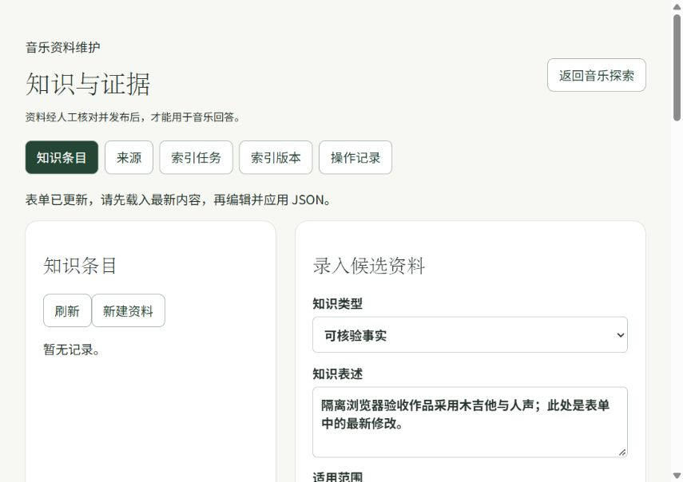
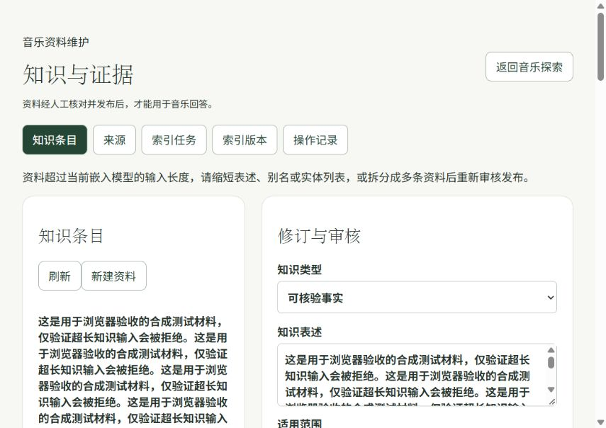
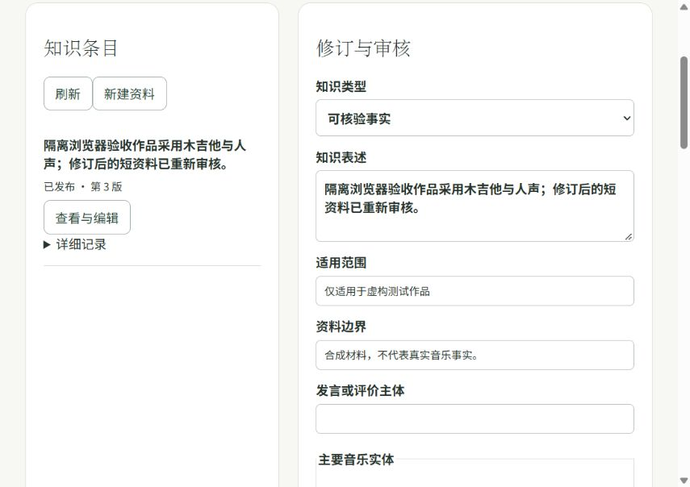

# RAG 浏览器验收记录

验收日期：2026-11-10。使用当前 `feature/rag-knowledge-base` 分支源码，实际操作内置浏览器中的 `http://127.0.0.1:15173/#knowledge`。前端代理到独立的 Java、MySQL、Redis、RabbitMQ、Agent、知识 Worker 和 Milvus 2.4.23，未使用现有业务数据库。

## 验收结果

| 场景 | 浏览器实际结果 |
| --- | --- |
| 普通用户权限 | 普通测试账号已登录，进入知识维护页仍被拦截；维护者可进入 |
| 表单 → JSON | 录入表述、WORK 标识及支持材料后，展开 JSON 展示最新填写内容 |
| JSON 冲突 | 编辑 JSON 后再次修改表单，应用被拒绝并提示重新载入；表单最新内容保留 |
| 重新载入及保存 | 载入最新表单后添加别名，保存成功，别名和最新表述均保留；状态为尚未发布 |
| 审核门槛 | 未审核版本不能发布，页面提示“请先审核通过当前版本，再发布。” |
| 发布与检索 | 第 1 版经审核后成功发布；页面检索返回 `hit`，精确和向量候选均为 1 |
| 超长修订 | 合法字段长度的 1860 字符合成表述保存为第 2 版并经审核；发布前被真实固定模型分词器拒绝，提示缩短或拆分；发布指针仍为第 1 版，且第 2 版无索引任务 |
| 缩短后重发 | 缩短为第 3 版，重新审核发布成功；检索只返回第 3 版，精确和向量候选均为 1 |
| 撤回 | 页面确认撤回后显示已撤回；再次检索返回 `no_match`、空证据，向量通道可用 |

所有音乐表述、作品 ID、来源和账号均为自行生成的隔离测试材料，不证明真实音乐事实。未调用真实 LLM Provider，也未以本轮验收代替真实语料的检索质量评测。

## 验收发现并修复

1. 未审核发布原先直接展示内部错误码 `APPROVAL_REQUIRED`，已改为明确的中文操作提示。
2. 新草稿与旧发布版本并存时，列表原先误显示“已发布 · 第 2 版”。已改为分别显示“第 1 版已发布 · 第 2 版待审核/审核通过”；发布第 3 版后显示“已发布 · 第 3 版”。新增 3 项回归测试覆盖草稿、审核通过及其他终态。

修复后前端 **32 项测试通过**，TypeScript/Vite 生产构建及 `git diff --check` 通过。浏览器复验确认了上述两处提示。前一轮 Java 47 项、Agent 124 项回归结果见 [RAG 验证记录](./rag-validation.md)。

## 页面证据

表单后续修改不会被旧 JSON 覆盖：

超长资料在发布前被拒绝：

缩短后第 3 版发布成功：

## 环境清理

验收结束后撤回合成资料，并销毁本次独立容器、数据库及临时源码；保留原项目服务、业务数据和已有模型缓存。截图为正常留存的验收证据。
